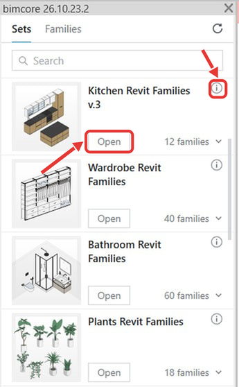

## Open a set's Revit project or insert a family

1. On Revit's **Add-Ins** tab, click **Panel**. Your purchased INT LINES sets appear if you are signed in with the email address used for your order.
2. Wait 1–2 minutes for the sets to download.

### Open a set's Revit project

1. In the plugin window, click **Open** below the set you want to use.
2. The set's project opens in Revit.

### Insert a family

1. Open your project in Revit.
2. In that project, open the view where you want to place the family.
3. In the plugin window, click **N families** below the set you want to use.
4. The set's families appear.

5. Click **Insert** next to the family you want to place.
6. Click a location in the open Revit view.
7. The family appears at that location in your project.
8. Press **Esc** twice to stop placing the family.

If you need help, email us at `mail@bimcore.one`.

Continue to [Search, set details and content language](/guides/bimcore-plugin/panel).

<CTA type="plugin" />
