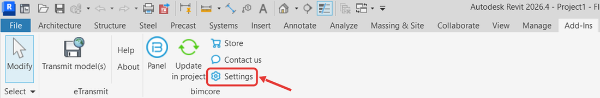
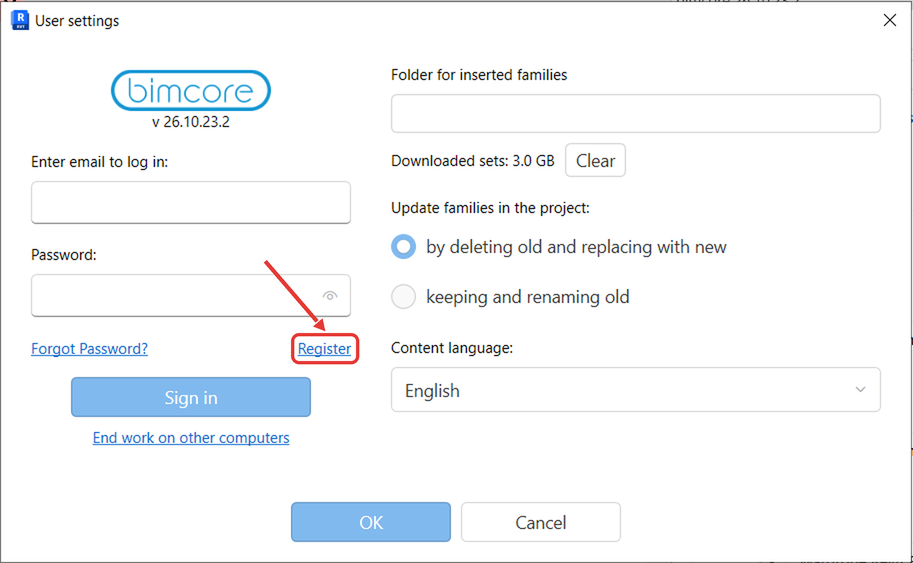
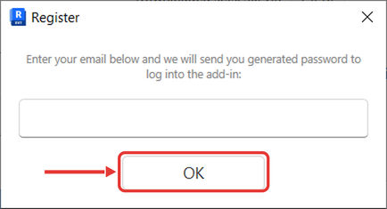
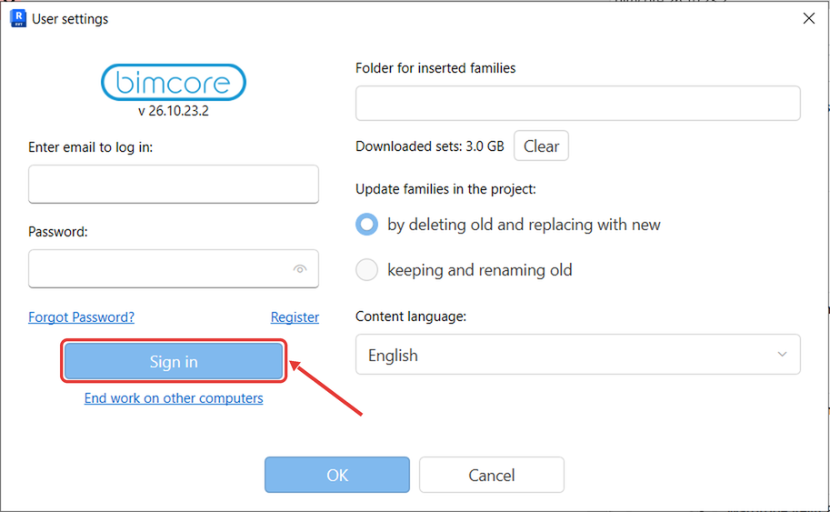

## Register and sign in

1. In Revit, select the **Add-Ins** tab.
2. On the **Add-Ins** tab, click **Settings**.

3. The **User settings** window opens.
4. In **User settings**, click **Register**.

5. The **Register** window opens.
6. In **Register**, enter the email address you used for your order in **Email**. If you have not purchased a set, use your own email address.
7. In **Register**, click **OK**.

8. The message "New password has been sent to your email." appears.
9. Open your email inbox.
10. Find the email with the subject "BIMCORE Revit Add-in" in your inbox or spam folder.
11. Open that email.
12. In **User settings**, enter the email address you registered with.
13. In **User settings**, enter the password from the email in **Password**.

14. In **User settings**, click **Sign in**.

Do not enter your INT LINES store account password.

## Reset your password

1. On Revit's **Add-Ins** tab, click **Settings**. In **User settings**, enter the email address you registered with and click **Forgot Password?**.
2. A new password arrives by email.
3. Open your email inbox.
4. Open the email containing your new password.
5. In **User settings**, enter the new password in **Password**.
6. In **User settings**, click **Sign in**.

If you need help, email us at `mail@bimcore.one`.

Continue to [Open a project and insert a family](/guides/bimcore-plugin/sets).

<CTA type="plugin" />
