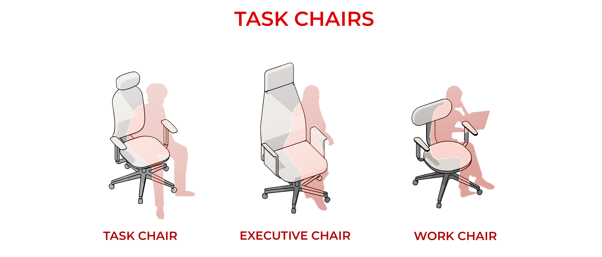
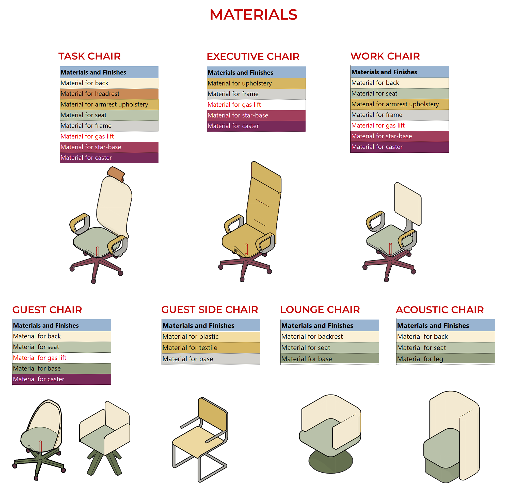

## 1. GENERAL INFORMATION

- Set name: Office Chairs
- Version 1.0.0
- Revit version: 2019

### Description

The Office Chairs set of families is designed for interior designers, architects, and other professionals working on office projects in Autodesk Revit. The model geometry is optimized for fast and stable performance in modern office projects.

### Loading and placing into the project

There are three ways to add families to your project:

**Copy and Paste:** Open the project file containing the office chairs, select the required models, copy them [Ctrl+C], and paste them [Ctrl+V] into your project. *Only the selected family types will be copied to the new project.*

**Drag and Drop:** Open the folder containing the family files and drag the required families directly into the Revit window.

**Via the Revit ribbon:** On the **Insert** tab, click **Load Family**, select the required .rfa files, and click **Open**.

## 2. SET STRUCTURE

Set includes two groups: **Task Chairs** and **Guest Chairs**. It contains 7 universal families in the *Furniture* category.

### Task Chairs

Chairs designed for employees who spend long periods working at their desks. Ergonomics and mobility are the main features of this group.

**Task chair** — a mobile, adjustable chair with casters for everyday work.

**Executive chair** — an ergonomic high-back chair with extra comfort, designed for senior management.

**Work chair** — a compact work chair with a lightweight design and a low backrest, suitable for saving space.

### Guest Chairs

Chairs designed for short-term use by visitors, clients, and colleagues in waiting areas, lounges, and meeting rooms.

**Guest chair** — a lightweight, mobile chair for quick meetings at a desk.

**Guest side chair** — a stationary chair for comfortable visitor seating in offices.

**Lounge chair** — a low, soft, and wide chair for informal meetings and relaxation in lounge areas.

**Acoustic chair** — a chair with high sound-insulating side panels for private work and confidential calls.

## 5. MATERIALS AND FINISHES

Materials define the finish of individual model elements, such as the seat, frame, and other parts. All of them are grouped under **Materials and Finishes**, and each family has its own specific set:

- *Task chair:* backrest, headrest, armrest upholstery, seat, frame, gas lift, star base, and caster materials.
- *Executive chair:* upholstery, frame, gas lift, star base, and caster materials.
- *Work chair:* backrest, seat, armrest upholstery, frame, gas lift, star base, and caster materials.
- *Guest chair:* backrest, seat, gas lift, base, and caster materials.
- *Guest side chair:* plastic, textile, and frame materials.
- *Lounge chair:* backrest, seat, and base materials.
- *Acoustic chair:* backrest, seat, and base materials.

The names of the chair components (backrest, seat, star base, gas lift, etc.) are shown in the family elements diagram in Section 3.

