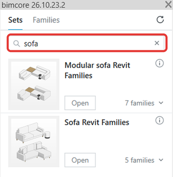
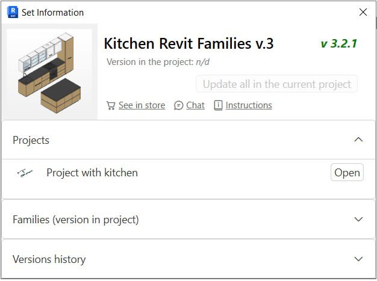
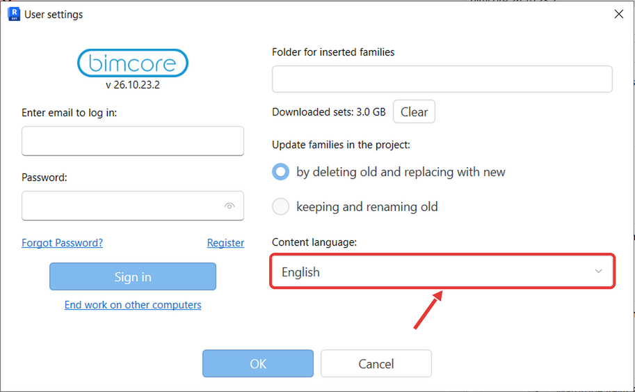

El panel del plugin tiene un campo **Search** y un icono **i** en cada set. En **Search** puedes buscar un set o una familia por su nombre. El icono **i** abre la ventana **Set Information**, que contiene los botones **Chat** e **Instructions** y las secciones **Projects**, **Families (version in project)** y **Versions history**.

En la ventana **User settings**, el campo **Content language:** te permite elegir ruso o inglés como idioma de las familias.

## Busca un set o una familia

En el panel del plugin, escribe el nombre del set o de la familia en **Search**.

## Abre Set Information

En el panel del plugin, haz clic en el icono **i** de la esquina superior derecha del set que quieras consultar.

## Elige el idioma de las familias

Si los sets aún no se han descargado en el idioma que elijas, el plugin mostrará un aviso. La descarga comenzará cuando hagas clic en **OK**.

1. En Revit, haz clic en **Settings** en la pestaña **Add-Ins**.
2. En **User settings**, selecciona **Russian** o **English** en **Content language:** y haz clic en **OK**.

   

Si necesitas ayuda, escríbenos a [mail@bimcore.one](mailto:mail@bimcore.one).

<CTA type="plugin" />
