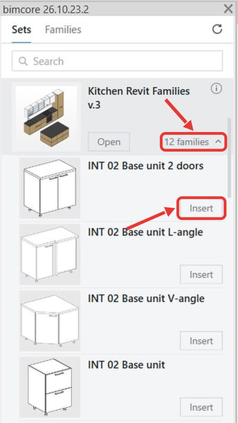

Después de iniciar sesión, verás en el panel del plugin los sets de INT LINES que has comprado. Si no aparecen, inicia sesión con la dirección de correo de tu pedido.

Las familias gratuitas están en un set independiente llamado **Free families**.

Debajo del nombre de cada set encontrarás el botón **Open** y el número de familias, por ejemplo, **12 families**. **Open** abre el proyecto del set. Al hacer clic en el número de familias, se despliega la lista. Cada familia tiene un botón **Insert** para colocarla en tu propio proyecto.

## Abre el proyecto de un set

En el panel del plugin, haz clic en **Open** debajo del set que quieras abrir.

## Inserta una familia en tu proyecto

1. Abre tu proyecto en Revit y la vista en la que quieras colocar la familia.
2. En el panel del plugin, haz clic en el número de familias debajo del set que quieras usar.

   

3. Haz clic en **Insert** para la familia que quieras colocar.
4. Haz clic en el punto de la vista donde quieras colocarla.
5. Pulsa **Esc** dos veces para terminar de colocar familias.

Si necesitas ayuda, escríbenos a [mail@bimcore.one](mailto:mail@bimcore.one).

Continúa con [Buscar una familia, consultar la información de un set y elegir el idioma](/guides/bimcore-plugin/panel).

<CTA type="plugin" />
