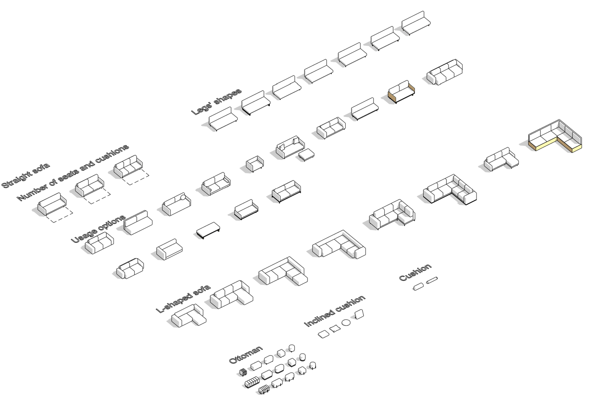
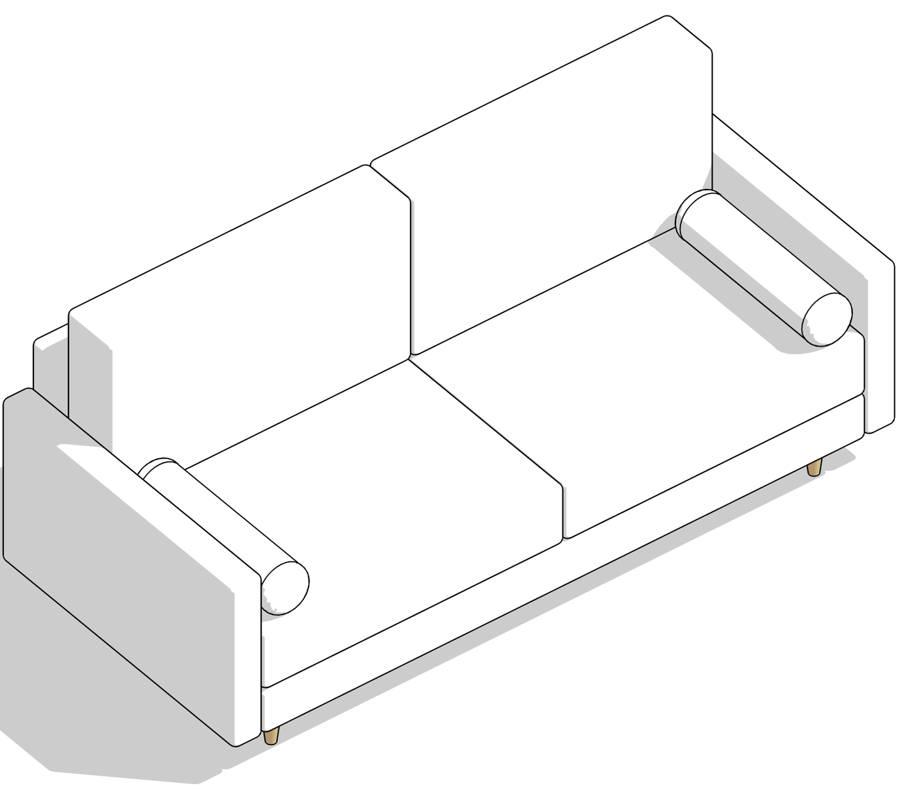

## Abre el proyecto de un set o inserta una familia

1. Al iniciar sesión, verás en la ventana del plugin los sets que compraste con esa misma dirección de correo.
2. Espera entre 1 y 2 minutos a que termine la descarga de los sets.

### Abre el proyecto del set

1. En la ventana del plugin, haz clic en **Open** debajo del set que quieras abrir.
2. Se abrirá el proyecto del set seleccionado.

### Inserta una familia

1. Abre tu proyecto en Revit.
2. En tu proyecto, abre la vista en la que quieras insertar la familia.
3. En la ventana del plugin, haz clic en **N families** debajo del set que quieras usar.
4. Verás las familias de ese set.

5. Haz clic en **Insert** junto a la familia que quieras insertar.
6. Haz clic en el punto de la vista de Revit donde quieras colocarla.
7. Verás la familia colocada en la vista.

8. Presiona **Esc** dos veces para salir del modo de inserción.

Si tienes algún problema, escríbenos a `mail@bimcore.one`.

Continúa con [Búsqueda, ficha del set e idioma](/guides/bimcore-plugin/panel).

<CTA type="plugin" />
