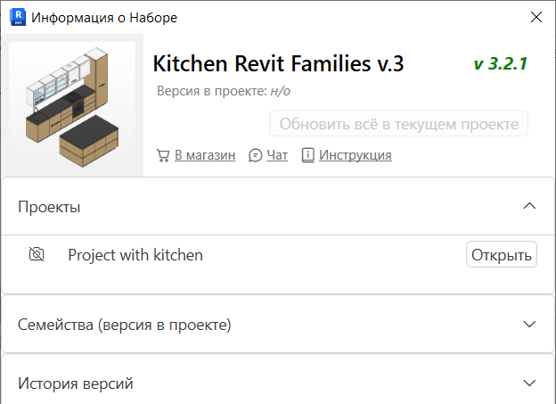
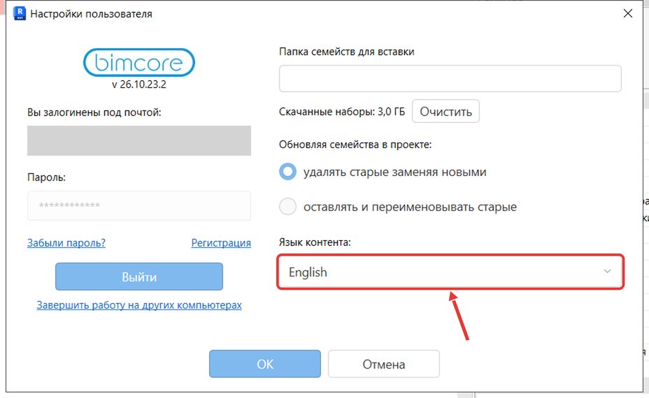

В панели плагина вы увидите поле **Поиск** и значок **i** у каждого набора. В поле **Поиск** можно найти набор или семейство по названию. Значок **i** открывает окно **Информация о Наборе**. В окне есть кнопки **Чат** и **Инструкция**, разделы **Проекты**, **Семейства (версия в проекте)** и **История версий**.

В окне **Настройки пользователя** есть поле **Язык контента:**, в котором можно выбрать русский или английский язык семейств.

## Чтобы найти набор или семейство

В панели плагина введите название набора или семейства в поле **Поиск**.

## Чтобы открыть окно **Информация о Наборе**

В панели плагина нажмите значок **i** в правом верхнем углу нужного набора.

{/* СНИМОК ЗАМЕНИТЬ: карточка «Информация о Наборе» русского набора. */}

## Чтобы выбрать язык семейств

1. В Revit на вкладке **Надстройки** нажмите **Настройки**.

Если на выбранном языке наборы ещё не скачаны, плагин предупредит и после **OK** начнёт скачивание.

2. В окне **Настройки пользователя** в поле **Язык контента:** выберите **Русский** или **English** и нажмите **ОК**.

Если что-то не получилось, напишите нам в Telegram [https://t.me/IntLinesSupportBot](https://t.me/IntLinesSupportBot).

<CTA type="plugin" />
