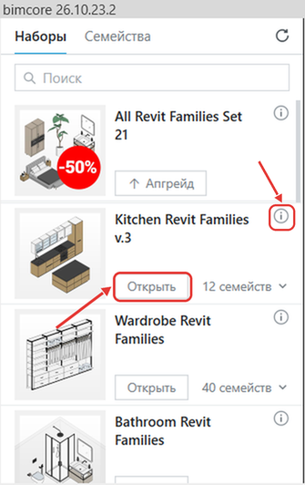
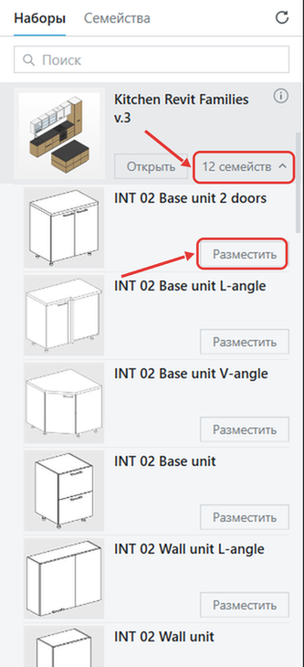

## Откройте проект набора или разместите семейство

1. После входа в окне плагина появится набор Free families с бесплатными семействами INT LINES.
2. Рядом появятся приобретённые наборы, если заказ оформлен на ту же почту.

{/* СНИМОК ЗАМЕНИТЬ (утро, после входа владельца): панель с РУССКИМИ наборами, язык контента «Русский»; рамки на «Открыть» и значок i. */}

{/* СНИМОК ЗАМЕНИТЬ: раскрытый РУССКИЙ набор; рамки на «N семейств» и «Разместить». */}

3. Дождитесь скачивания наборов. Это займёт 1–2 минуты.

### Откройте проект набора

1. В окне плагина нажмите **Открыть** под нужным набором.
2. Откроется проект набора.

### Разместите семейство

1. Откройте в Revit свой проект и нужный вид.
2. В окне плагина нажмите **N семейств** под нужным набором.
3. Появятся семейства набора.
4. У нужного семейства нажмите **Разместить**.
5. Щёлкните на открытом виде Revit.
6. Семейство появится в проекте.
7. Дважды нажмите **Esc**.

Если что-то не получилось, напишите нам в Telegram [https://t.me/IntLinesSupportBot](https://t.me/IntLinesSupportBot).

Перейдите к разделу [Поиск, карточка набора и язык](/guides/bimcore-plugin/panel).

<CTA type="plugin" />
