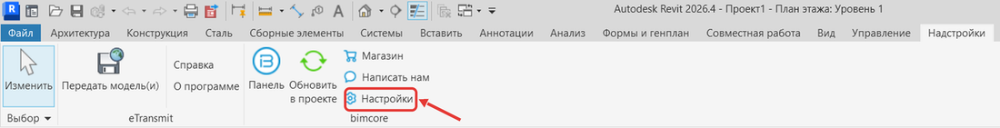
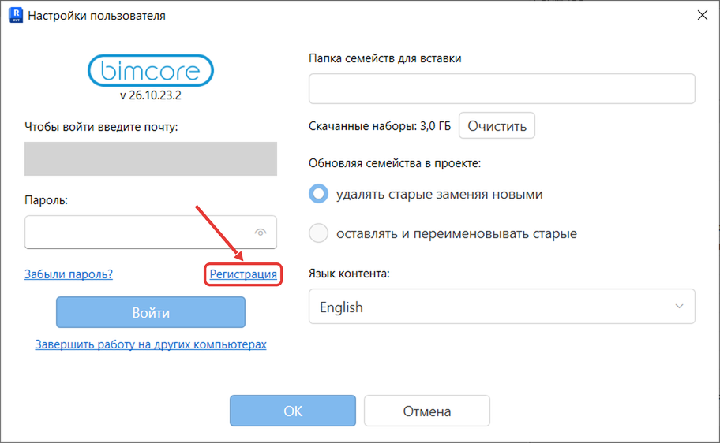
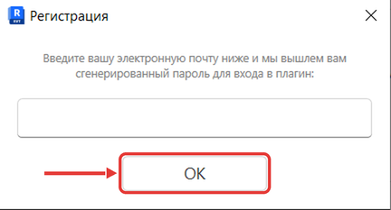
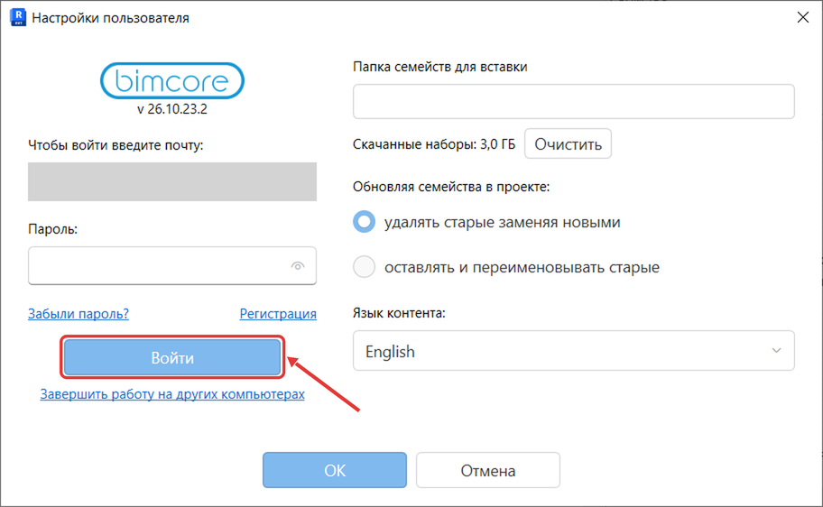

Revit открыт, выбрана вкладка **Надстройки**.

## Зарегистрируйтесь и войдите

1. На вкладке **Надстройки** нажмите **Настройки**.

2. Откроется окно **Настройки пользователя**.
3. В окне **Настройки пользователя** нажмите **Регистрация**.

4. Появится окно **Регистрация**.
5. В окне **Регистрация** введите почту из заказа. Если вы не приобретали наборы, введите свою почту.
6. В окне **Регистрация** нажмите **ОК**.

7. Появится надпись «Новый пароль был выслан на вашу почту.»
8. Откройте свою почту.
9. Найдите письмо с темой «BIMCORE Revit Add-in» во входящих или в папке «Спам».
10. Откройте письмо.
11. В окне **Настройки пользователя** введите почту, указанную при регистрации.
12. Введите пароль из письма.

13. Нажмите **Войти**.

Не вводите пароль от личного кабинета магазина INT LINES.

## Если нужно: забыли пароль

1. В окне **Настройки пользователя** нажмите **Забыли пароль?**.
2. На почту придёт новый пароль.
3. Откройте свою почту и письмо с новым паролем.
4. Введите новый пароль в окне **Настройки пользователя**.
5. Нажмите **Войти**.

Если что-то не получилось, напишите нам в Telegram [https://t.me/IntLinesSupportBot](https://t.me/IntLinesSupportBot).

Перейдите к разделу [Наборы: открыть проект и разместить семейство](/guides/bimcore-plugin/sets).

<CTA type="plugin" />
