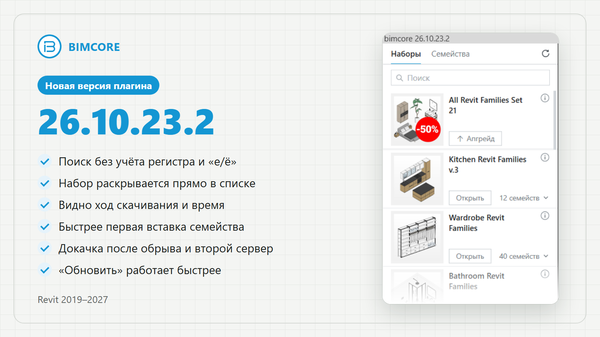

## Версия 26.10.23.2

Выпущена 23 октября 2026 года.

### Скорость и стабильность

- Уменьшили задержку при запуске Revit, связанную с загрузкой плагина.
- Исправили ошибки установки, входа и регистрации у некоторых пользователей.
- Исправили ошибки скачивания файлов.
- Ускорили скачивание семейств. Добавили докачку после обрыва и переключение между серверами при проблемах со связью.
- Сократили общее время первой вставки семейства и задержку после её отмены.
- Ускорили обновление списка наборов и переключение на уже скачанный язык.
- Ускорили поиск. Теперь он не зависит от регистра букв и одинаково обрабатывает «е» и «ё».

### Интерфейс и удобство

- Добавили раскрытие набора: посмотреть его семейства можно прямо в списке.
- Добавили отображение хода скачивания и приблизительного оставшегося времени.
- Сделали переключение между вкладками «Наборы» и «Семейства» более наглядным.
- При переключении вкладок строка поиска очищается.

<CTA type="plugin" />
