## 1. ОБЩИЕ ДАННЫЕ

- Название набора: Офисные кресла
- Версия набора 1.0.0
- Версия Revit: 2019

### Описание

Набор BIM-моделей **Офисные кресла** разработан специально для дизайнеров, архитекторов, специалистов компаний, занимающихся проектированием офисных пространств в Autodesk Revit.
Геометрия моделей оптимизирована средствами Revit для быстрой и стабильной работы в проектах современных бизнес-интерьеров.

### Загрузка моделей

Добавить семейства в свой проект можно двумя способами:

**Копированием:** Откройте файл проекта с офисными креслами, выберите нужные модели набора, скопируйте [Ctrl+C] и вставьте [Ctrl+V] в рабочий проект. *При таком переносе в новый проект будут скопированы только выделенные  типы семейства.*

**Перетаскиванием:** Откройте папку с файлами семейств и перетащите нужные элементы мышкой напрямую в окно Revit.

## 2. СОСТАВ НАБОРА

*Офисные кресла* состоят из 2 групп: **рабочие** и **гостевые** кресла. Всего 7 универсальных семейств категории *Мебель*.

**Кресла рабочие**

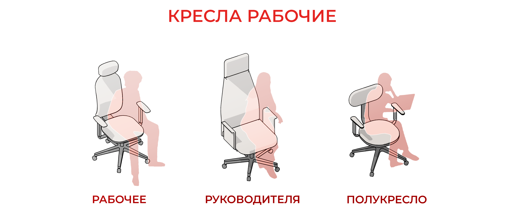

Мебель для длительной индивидуальной работы сотрудников, где ключевым фактором является эргономика и мобильность.

**Кресло рабочее** — мобильное регулируемое кресло на колесиках для ежедневной работы.

**Кресло руководителя** — статусное эргономичное кресло с высокой спинкой и повышенным уровнем комфорта для топ-менеджмента.

**Полукресло** — компактный рабочий стул облегченной конструкции с невысокой спинкой для экономии пространства.

**Кресла гостевые**

Мебель для кратковременного сидения посетителей, клиентов или коллег в зонах ожидания, отдыха и переговоров.

**Кресло гостевое** — легкий мобильный стул для быстрых встреч и совещаний у рабочего стола.

**Полукресло гостевое** — стационарный стул для комфортного приема посетителей в кабинетах.

**Кресло лаунж** — низкое, мягкое и широкое кресло для неформального общения и отдыха в лаунж-зонах.

**Кресло акустическое** — кресло с высокими звукоизолирующими стенками для уединенной работы и конфиденциальных звонков.

## 3. ОБЩИЕ ЭЛЕМЕНТЫ
   

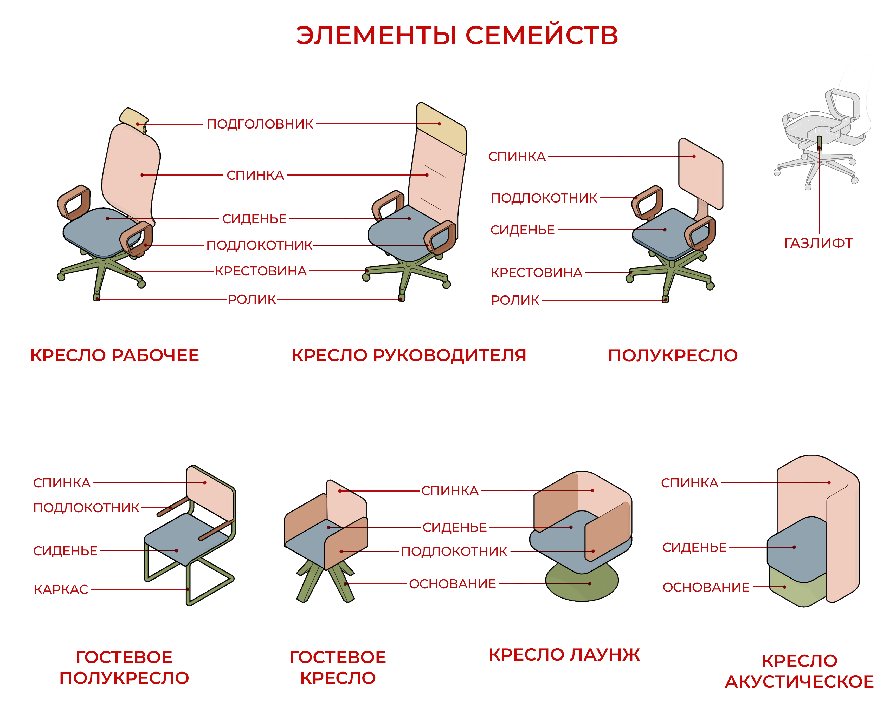

**Видимость** управляет отображением элементов семейства.

Вариативность наличия **подлокотника** предусмотрена в семействах:

- *Кресло рабочее*
- *Полукресло*
- *Кресло гостевое*
- *Полукресло гостевое*
- *Кресло лаунж*

**Опции** отвечают за вариативность элементов семейств: переключают его состояние, параметры и доступные модификации.

Опция регулировки общей формы по степени угловатости, **прямолинейная** или **скругленная форма кресла**, заложена для семейств:

- *Кресло рабочее*
- *Кресло руководителя*
- *Полукресло*
- *Кресло гостевое*
- *Кресло лаунж*

**Габариты** определяют общие геометрические параметры: ширину, глубину и высоту кресла. Все дополнительные элементы и опции, например, подголовник или подлокотники, вписываются в эти габариты. Базовые размеры на плане определяются шириной и глубиной корпуса кресла (не основанием изделия).

Семейства имеют габариты c общим префиксом **INT** и **ADSK**, которые можно выводить в спецификации.

**Размещение** отвечает за положение частей и элементов в семействе.

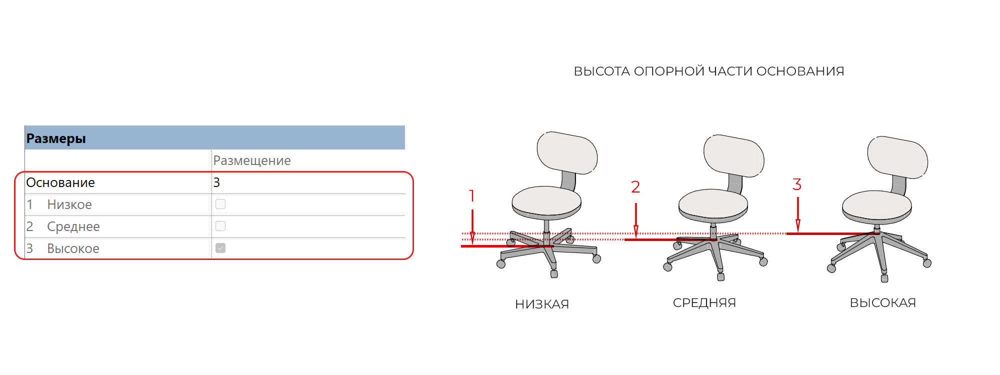

В семейства кресел вложена функция фиксации высоты опоры основания в 3 положениях: 1 — низкое, 2 — среднее, 3 — высокое. Размещение доступно для семейств:

- *Кресло руководителя*
- *Полукресло*
- *Кресло гостевое*
- *Кресло лаунж*

   
**Размеры элементов** задают пропорции отдельных частей и составляющих семейства. Габарит высоты складывается из суммы размеров двух элементов: высоты сиденья и высоты спинки.

Высота сиденья — отметка от пола до посадочной поверхности. Высота спинки — размер от высоты сиденья до верха спинки. 

### **4. СЕМЕЙСТВА**

### Кресло рабочее
  

**Обивка подлокотника** как дополнительная визуальная опция работает для семейств:

- *Кресло рабочее*
- *Полукресло*
  

**Подголовник** по кнопке регулируется для семейств:

- *Кресло рабочее*
- *Кресло руководителя*
  

Заложена опция видимости **задней стенки спинки** в цвет каркаса.

Для рабочего кресла предусмотрено 3 типа подлокотников: **замкнутый**, **Т-образный** и **Z-образный**.

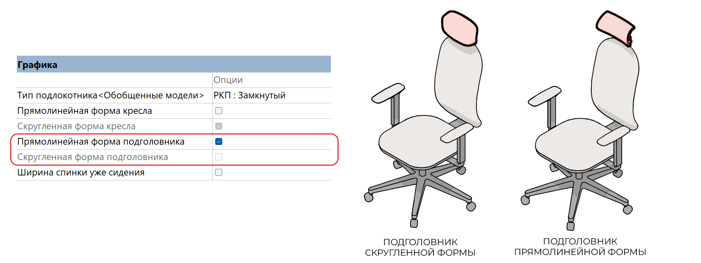

Доступна настройка формы подголовника: **прямолинейная** или **скругленная**.

Опционально настраивается **сужение ширины спинки** относительно сиденья для семейств:

- *Кресло рабочее*
- *Полукресло*

### Кресло руководителя

  

Видимость соединения под сиденьем – **поперечины** – работает для семейства *Кресло руководителя*. Для визуальной эстетики кресла советуем использовать этот параметр только для типов подлокотника *Прямой* и *Г-образный*.

Для *Кресла руководителя* предусмотрено 4 типа подлокотников: **боковое крепление**, **Г-образный**, **замкнутый** или **прямой**.

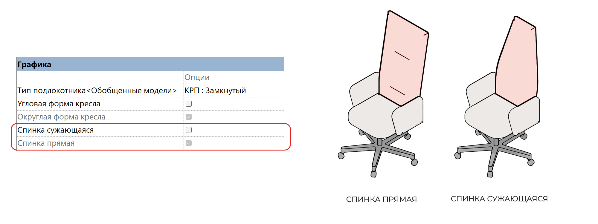

Отдельно настраивается **сужение верхней части спинки**.

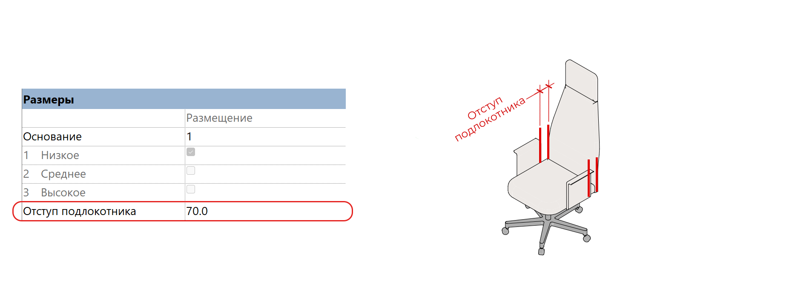

Подлокотники типа *Г-образный* и *Замкнутый* могут **отступать от сиденья**, образуя зазор.

### Полукресло
  

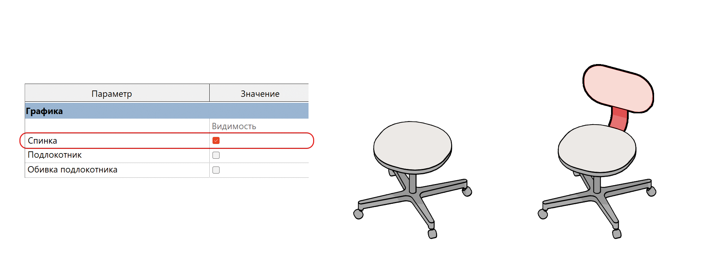

Иногда **спинка** только мешает рабочему процессу — функция ее вариативности заложена для сидений:

- *Полукресло*
- *Кресло лаунж*

Для *Полукресла* предусмотрено 3 типа подлокотников: **Г-образный**, **замкнутый** или **Т-образный** подлокотник.

Заложены 3 варианта **высоты спинки**, которые регулируются с помощью введения цифры: 1 – короткая спинка, 2 – средней длины спинка, 3 – длинная спинка до сиденья.

Типы оснований семейства *Полукресло*: **5-лучевая** или **4-лучевая крестовина**.

### Кресло гостевое

Спинка *Гостевого кресла* может быть **скошенной** или **прямой**. Дополнительно прямая спинка укорачивается по высоте отдельным типом из списка (**прямая короткая**), но только для прямоугольной формы кресла.

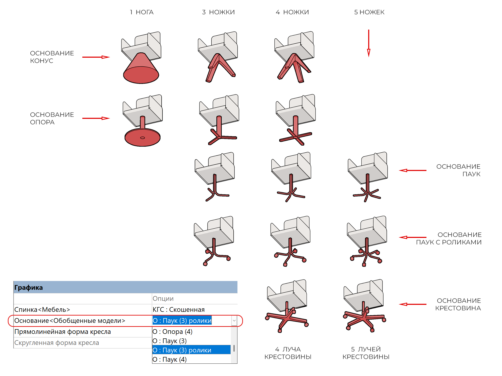

Типы оснований для *Гостевого кресла*: **конус**, **опора**, **паук**, и **крестовина**. Цифра в скобках — (1), (3), (4) или (5) — подскажет количество ножек у опоры. Ножки-пауки могут быть с роликами.

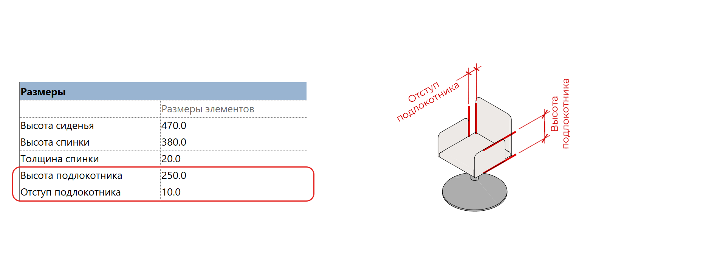

Для *прямолинейной формы кресла* с *прямой спинкой* доступны функции регулировки **высоты подлокотника** и его **отступа** от спинки.

### Полукресло гостевое

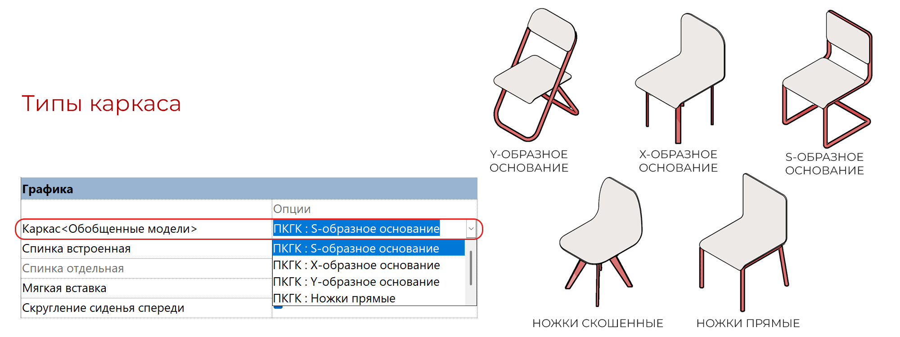

Внутри семейства заложено 5 типов каркаса: с **прямыми** и **скошенными ножками**, каркасы **Y-образной**, **X-образной** и **S-образной формы**. Типы каркаса влияют не только на основание, но и на форму корпуса кресла.

Добавлен сценарий **встроенной** или **отдельной спинки**. Конфигурация кресла может меняться в зависимости от типа каркаса, при этом опция разделения спинки работает для любой конфигурации.

**Скругление сиденья спереди** работает для всех типов каркаса, кроме *Ножки прямые* и *Ножки скошенные*.

Также опционально для этого семейства можно интегрировать текстильную **мягкую вставку**. В зависимости от конфигурации каркаса она может заменить твердую спинку, все сиденье целиком, включая подлокотники, или добавиться на сиденье отдельной вставкой.

### Кресло лаунж

У этого мягкого кресло можно **закрыть сиденье спинкой**.

Есть несколько типов оснований: **конус**, **опора** и **прямоугольник**. Цифра в скобках — (1), (3) или (4) — указывает на количество ножек у опоры.

При *скругленной форме кресла* можно вручную настроить закругления на плане: **передний** и **задний радиусы**.

При *прямолинейной форме кресла* активна функция настройки **высоты подлокотника**. Толщина подлокотника по умолчанию такая же как толщина спинки.

### Акустическое кресло

Для семейства предусмотрена функция дополнительного **основания** под сидением. При выключении этой видимости данную роль выполняет сиденье, дотягиваясь по высоте до пола.

Типы оснований: **квадратные** или **круглые ножки**, **цоколь**, **Х-основание** и **пусто** (пустое пространство под сиденьем).

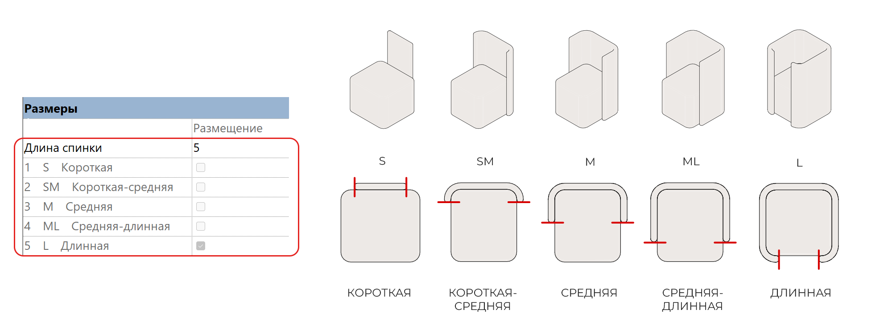

Вариации **длины закрывающей спинки** регулируются цифрами от 1 до 5, где 1 — самая короткая, 5 — самая длинная.

Полный список включает 5 положений:

1 — S — Короткая

2 — SM — Короткая-средняя

3 — M — Средняя

4 — ML — Средняя-длинная

5 — L — Длинная

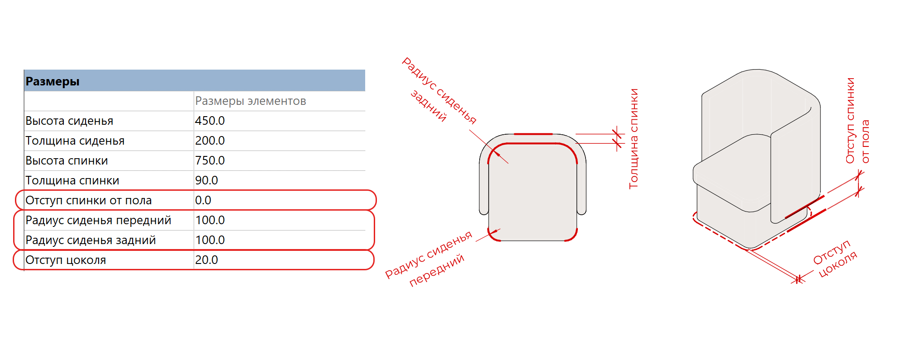

Акустическая спинка может доходить до самого пола, играя роль опоры. Регулировка этого параметра заложена через **отступ спинки от пола**.

**Отступ цоколя** доступен только в связке с одноименным типом основания.

**Радиусы скругления** сиденья здесь работают немного иначе чем в *Лаунж кресле*: если там радиусы задаются по касательной к габаритным размерам, то в *Акустическом кресле* привязка **переднего** и **заднего радиусов** именно к сиденью кресла.

### МАТЕРИАЛЫ И ОТДЕЛКА

Материалы** задают отделку отдельных частей модели (сиденья, каркаса и др.) 

