import productPreview from './product.png';

<ProductCard image={productPreview} ecwidProductId="879069013" shopUrl="https://int-lines.com/revit-families/semeystva-ofisnye-kresla/" name="Офисные кресла для Revit" description="7 семейств и 70 типов офисных кресел: рабочие, руководителя, гостевые, лаунж и акустические" imageAlt="Офисные кресла для Revit — превью набора" buyUrl="https://bimcore.one/products/office-chairs" buyLabel="Посмотреть цену в магазине" />

## 1. ОБЩИЕ ДАННЫЕ

- Название набора: Офисные кресла
- Версия набора: 1.0.0
- Версия Revit: 2019 и выше

### Описание

Набор BIM-моделей «Офисные кресла» разработан специально для дизайнеров, архитекторов и специалистов компаний, занимающихся проектированием офисных пространств в Autodesk Revit.
Геометрия моделей оптимизирована средствами Revit для быстрой и стабильной работы в проектах современных бизнес-интерьеров.

### Загрузка моделей

Добавить семейства в свой проект можно тремя способами:

**Копированием:** Откройте файл проекта с офисными креслами, выберите нужные модели набора, скопируйте [Ctrl+C] и вставьте [Ctrl+V] в рабочий проект. *При таком переносе в новый проект будут скопированы только выделенные  типы семейства.*

**Перетаскиванием:** Откройте папку с файлами семейств и перетащите нужные файлы .rfa мышкой напрямую в окно Revit.

**Через ленту Revit:** На вкладке **Вставка** нажмите **Загрузить семейство**, выберите нужные файлы .rfa и нажмите **Открыть**.

## 2. СОСТАВ НАБОРА

Набор «Офисные кресла» состоит из 2 групп: **рабочие** и **гостевые** кресла. Всего 7 универсальных семейств категории «Мебель».

### Кресла рабочие

Эти кресла предназанчены для длительной индивидуальной работы сотрудников. Ключевым фактором для них является эргономика и мобильность.

**Кресло рабочее** — мобильное регулируемое кресло на колесиках.

**Кресло руководителя** — статусное эргономичное кресло с высокой спинкой и повышенным уровнем комфорта для топ-менеджмента.

**Полукресло** — компактный рабочий стул облегченной конструкции с невысокой спинкой для экономии пространства.

### Кресла гостевые

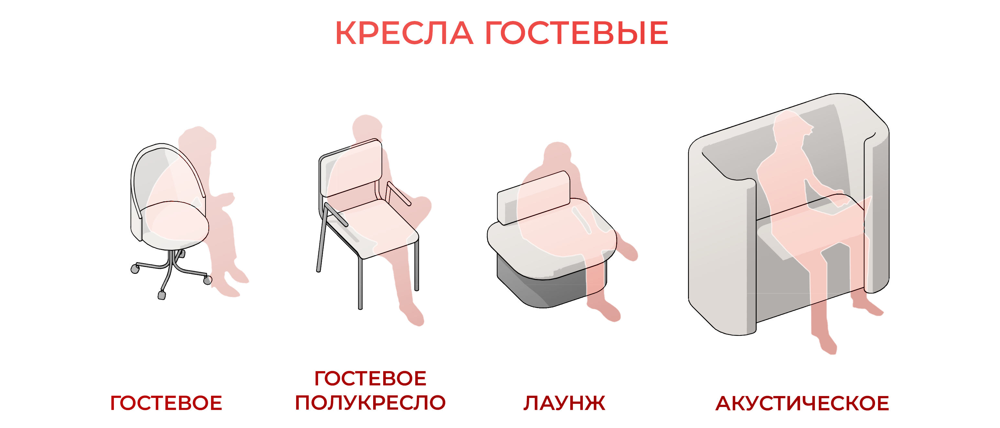

Мебель для кратковременного сидения посетителей, клиентов или коллег в зонах ожидания, отдыха и переговоров.

**Кресло гостевое** — легкий мобильный стул для быстрых встреч и совещаний у рабочего стола.

**Полукресло гостевое** — стационарный стул для комфортного приема посетителей в кабинетах.

**Кресло лаунж** — низкое, мягкое и широкое кресло для неформального общения и отдыха в лаунж-зонах.

**Кресло акустическое** — кресло с высокими звукоизолирующими стенками для уединенной работы и конфиденциальных звонков.

## 3. ОБЩИЕ ЭЛЕМЕНТЫ

### Из чего состоит кресло?
   

Семейства из набора **Офисные кресла** могут содержать следующие элементы:
- Подголовник
- Спинка
- Подлокотник
- Сиденье
- Каркас / Основание / Крестовина
- Газлифт (есть только у Крестовины)
  

### Включение элементов кресла

Видимостью отдельных элементов можно управлять в разделе **Видимость** в типоразамере семейства

Подлокотник можно выключить у следующих семейств:

- *Кресло рабочее*
- *Полукресло*
- *Кресло гостевое*
- *Полукресло гостевое*
- *Кресло лаунж*

### Изменение формы

В разделе **Опции**  вы найдете параметры, которые отвечают за вариативность разных элементов семейств: переключают его форму, тип и доступные модификации.

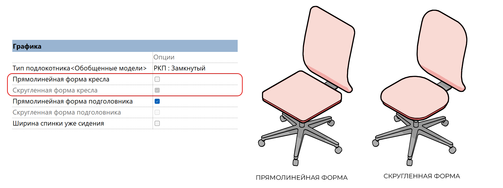

Чтобы изменить форму кресла доступно две опции **Прямолинейная форма кресла** и **скругленная форма кресла**.\
Изменить форму можно в следующих семействах:

- *Кресло рабочее*
- *Кресло руководителя*
- *Полукресло*
- *Кресло гостевое*
- *Кресло лаунж*

### Изменение габаритов

Чтобы изменить размеры кресла в группе параметров **Размеры** найдите подраздел **Габариты**. Здесь можно  задать общие габарытные размеры. 

Все дополнительные элементы и опции, например, подголовник или подлокотники, вписываются в эти габариты. Базовые размеры на плане определяются шириной и глубиной корпуса кресла (не основанием изделия).

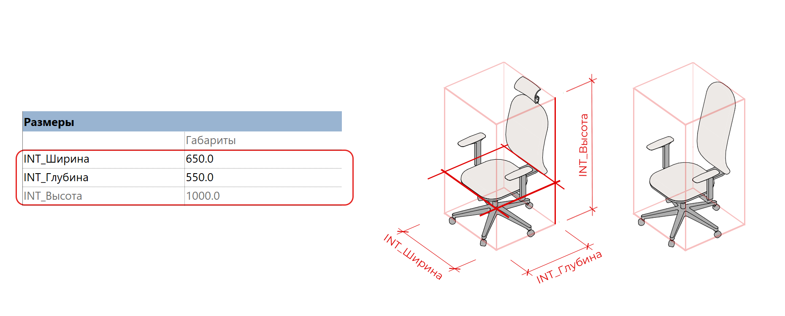

Семейства имеют габариты с общим префиксом **INT** и **ADSK**, которые можно выводить в спецификации. В группе **Размеры** это *INT_Ширина*, *INT_Глубина* и *INT_Высота*. В группе **Данные** лежат *ADSK_Размер_Ширина*, *ADSK_Размер_Глубина* и *ADSK_Размер_Высота*.

### Типы крестовин

В группе параметров **Размеры** подгруппа **Размещение** вы можете задать типы крестовин:

- Низкое
- Среднее
- Высокое

Данные параметры додступны для следующих семейств:

- *Кресло руководителя*
- *Полукресло*
- *Кресло гостевое*
- *Кресло лаунж*

### Размеры элементов
   
**Размеры элементов** позволяют гибко настраивать внешний вид семейства под ваши задачи.\
У большинства офисных кресел вы можете настроить такие параметры как:
- Высота спинки
- Высота сиденья
- Толщина сиденья

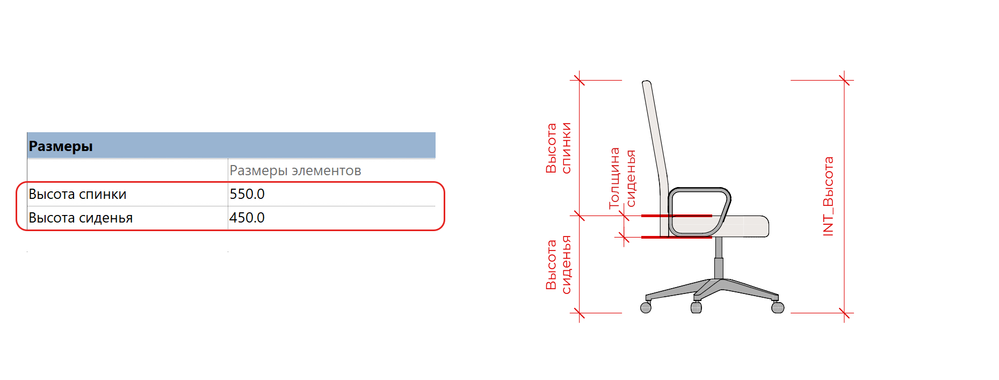

:::info[Информация]
Высота сиденья — отметка от пола до посадочной поверхности. 

Высота спинки — размер от высоты сиденья до верха спинки. 
:::

## 4. СЕМЕЙСТВА

### Кресло рабочее

Семейство предразначенно для рядовых сотрудников офиса.
  

**Обивка подлокотника** как дополнительная визуальная опция работает для семейств:

- *Кресло рабочее*
- *Полукресло*
  

**Подголовник** по кнопке регулируется для семейств:

- *Кресло рабочее*
- *Кресло руководителя*
  

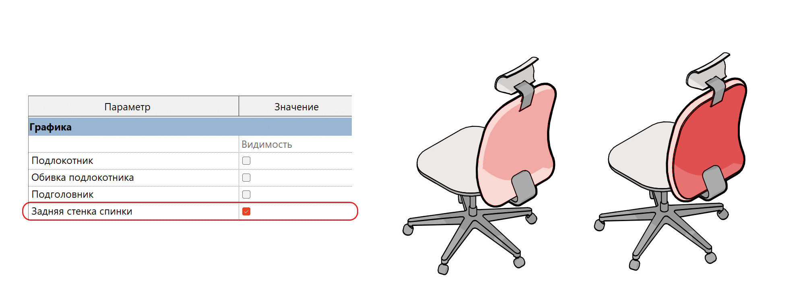

Заложена опция видимости **задней стенки спинки** в цвет каркаса.

Для рабочего кресла предусмотрено 3 типа подлокотников: **замкнутый**, **Т-образный** и **Z-образный**.

Доступна настройка формы подголовника: **прямолинейная** или **скругленная**.

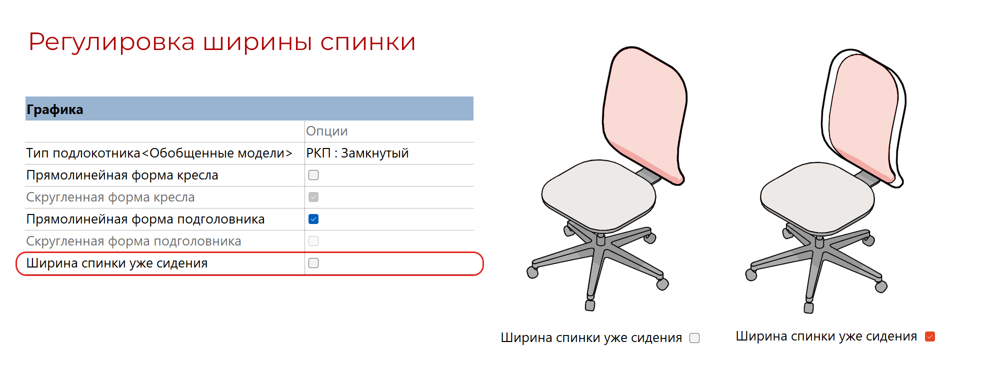

Опционально настраивается **сужение ширины спинки** относительно сиденья для семейств:

- *Кресло рабочее*
- *Полукресло*

### Кресло руководителя

Кресло руководителя предназначено для высшего менеджмента.

  

Видимость соединения под сиденьем – **поперечины** – работает для семейства *Кресло руководителя*. Для визуальной эстетики кресла советуем использовать этот параметр только для типов подлокотника *Прямой* и *Г-образный*.

Для *Кресла руководителя* предусмотрено 4 типа подлокотников: **боковое крепление**, **Г-образный**, **замкнутый** или **прямой**.

Отдельно настраивается **сужение верхней части спинки**.

Подлокотники типа *Г-образный* и *Замкнутый* могут **отступать от сиденья**, образуя зазор.

### Полукресло
  

Иногда **спинка** только мешает рабочему процессу — функция ее вариативности заложена для сидений:

- *Полукресло*
- *Кресло лаунж*

Для *Полукресла* предусмотрено 3 типа подлокотников: **Г-образный**, **замкнутый** или **Т-образный** подлокотник.

Заложены 3 варианта **высоты спинки**, которые регулируются с помощью введения цифры: 1 – короткая спинка, 2 – средней длины спинка, 3 – длинная спинка до сиденья.

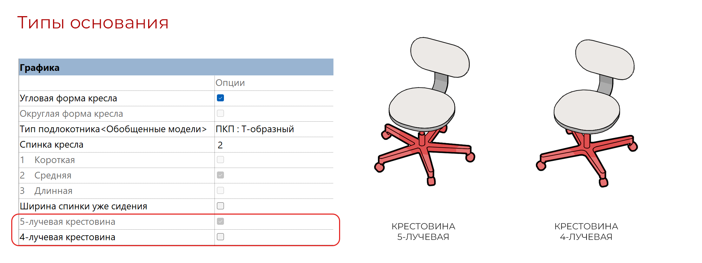

Типы оснований семейства *Полукресло*: **5-лучевая** или **4-лучевая крестовина**.

### Кресло гостевое

Спинка *Гостевого кресла* может быть **скошенной** или **прямой**. Дополнительно прямая спинка укорачивается по высоте отдельным типом из списка (**прямая короткая**), но только для прямоугольной формы кресла.

Типы оснований для *Гостевого кресла*: **конус**, **опора**, **паук**, и **крестовина**. Цифра в скобках — (1), (3), (4) или (5) — подскажет количество ножек у опоры. Ножки-пауки могут быть с роликами.

Для *прямолинейной формы кресла* с *прямой спинкой* доступны функции регулировки **высоты подлокотника** и его **отступа** от спинки.

### Полукресло гостевое

Внутри семейства заложено 5 типов каркаса: с **прямыми** и **скошенными ножками**, каркасы **Y-образной**, **X-образной** и **S-образной формы**. Типы каркаса влияют не только на основание, но и на форму корпуса кресла.

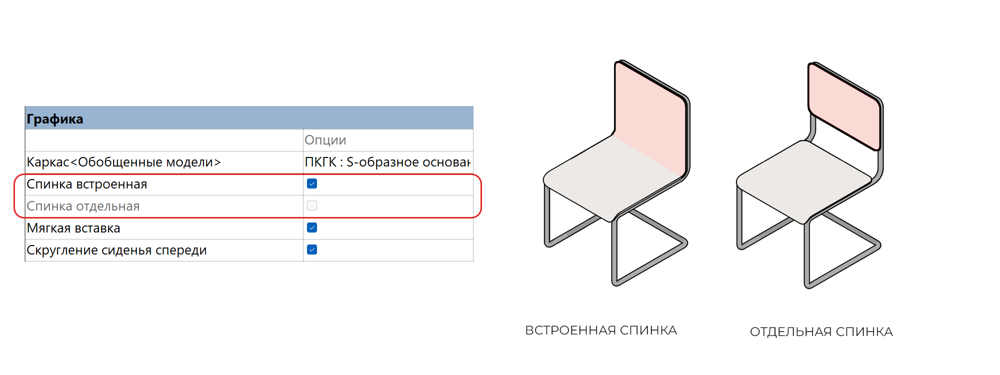

Добавлен сценарий **встроенной** или **отдельной спинки**. Конфигурация кресла может меняться в зависимости от типа каркаса, при этом опция разделения спинки работает для любой конфигурации.

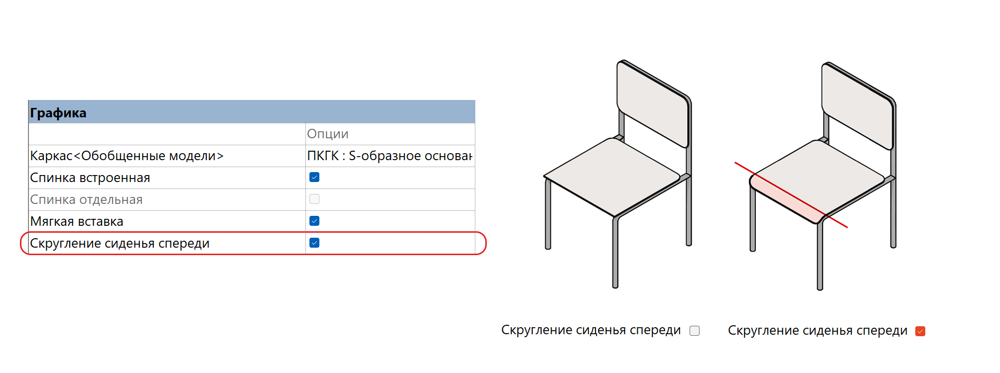

**Скругление сиденья спереди** работает для всех типов каркаса, кроме *Ножки прямые* и *Ножки скошенные*.

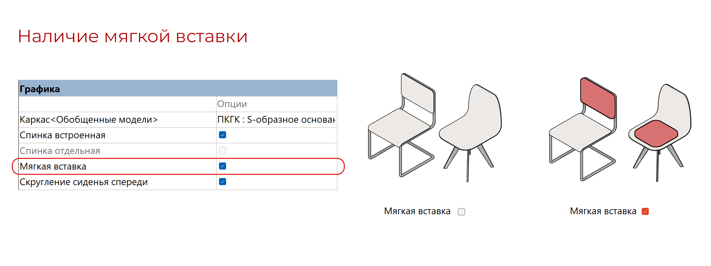

Также опционально для этого семейства можно интегрировать текстильную **мягкую вставку**. В зависимости от конфигурации каркаса она может заменить твердую спинку, все сиденье целиком, включая подлокотники, или добавиться на сиденье отдельной вставкой.

### Кресло лаунж

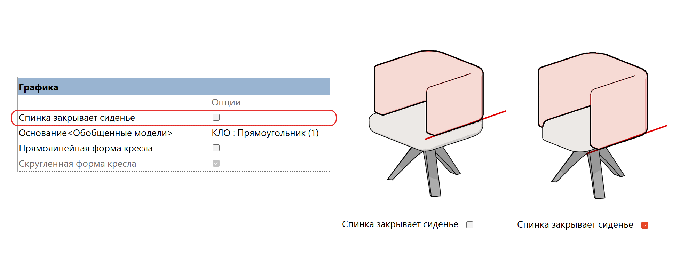

У этого мягкого кресло можно **закрыть сиденье спинкой**.

Есть несколько типов оснований: **конус**, **опора** и **прямоугольник**. Цифра в скобках — (1), (3) или (4) — указывает на количество ножек у опоры.

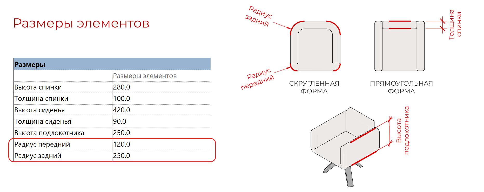

При *скругленной форме кресла* можно вручную настроить закругления на плане: **передний** и **задний радиусы**.

При *прямолинейной форме кресла* активна функция настройки **высоты подлокотника**. Толщина подлокотника по умолчанию такая же как толщина спинки.

### Акустическое кресло

Для семейства предусмотрена функция дополнительного **основания** под сидением. При выключении этой видимости данную роль выполняет сиденье, дотягиваясь по высоте до пола.

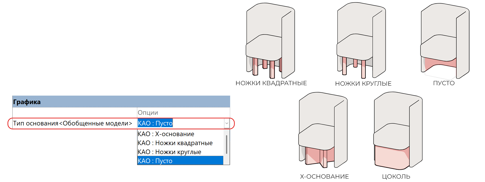

Типы оснований: **квадратные** или **круглые ножки**, **цоколь**, **Х-основание** и **пусто** (пустое пространство под сиденьем).

Вариации **длины закрывающей спинки** регулируются цифрами от 1 до 5, где 1 — самая короткая, 5 — самая длинная.

Полный список включает 5 положений:

1 — S — Короткая

2 — SM — Короткая-средняя

3 — M — Средняя

4 — ML — Средняя-длинная

5 — L — Длинная

Акустическая спинка может доходить до самого пола, играя роль опоры. Регулировка этого параметра заложена через **отступ спинки от пола**.

**Отступ цоколя** доступен только в связке с одноименным типом основания.

**Радиусы скругления** сиденья здесь работают немного иначе чем в *Лаунж кресле*: если там радиусы задаются по касательной к габаритным размерам, то в *Акустическом кресле* привязка **переднего** и **заднего радиусов** именно к сиденью кресла.

## 5. МАТЕРИАЛЫ И ОТДЕЛКА

Материалы задают отделку отдельных частей модели (сиденья, каркаса и др.). Все они собраны в группе **Материалы и отделка**, у каждого семейства свой набор:

- *Кресло рабочее*: материал спинки, подголовника, обивки подлокотника, сиденья, каркаса, газлифта, крестовины и роликов.
- *Кресло руководителя*: материал обивки, каркаса, газлифта, крестовины и роликов.
- *Полукресло*: материал спинки, сиденья, обивки подлокотника, каркаса, газлифта, крестовины и роликов.
- *Кресло гостевое*: материал спинки, сиденья, газлифта, основания и роликов.
- *Полукресло гостевое*: материал пластика, текстиля и каркаса.
- *Кресло лаунж*: материал спинки, сиденья и основания.
- *Кресло акустическое*: материал спинки, сиденья и основания.

Названия частей кресла (спинка, сиденье, крестовина, газлифт и другие) показаны на схеме элементов семейств в разделе 3.

