## 1. ОБЩИЕ ДАННЫЕ

- Название набора: Офисные кресла
- Версия набора 1.0.0
- Версия Revit: 2019

### Описание

Набор BIM-моделей **Офисные кресла** разработан специально для дизайнеров, архитекторов, специалистов компаний, занимающихся проектированием офисных пространств в Autodesk Revit.
Геометрия моделей оптимизирована средствами Revit для быстрой и стабильной работы в проектах современных бизнес-интерьеров.

### Загрузка моделей

Добавить семейства в свой проект можно двумя способами:

**Копированием:** Откройте файл проекта с офисными креслами, выберите нужные модели набора, скопируйте [Ctrl+C] и вставьте [Ctrl+V] в рабочий проект.

**Перетаскиванием:** Откройте папку с файлами семейств и перетащите нужные элементы мышкой напрямую в окно Revit.

## 2. СОСТАВ НАБОРА

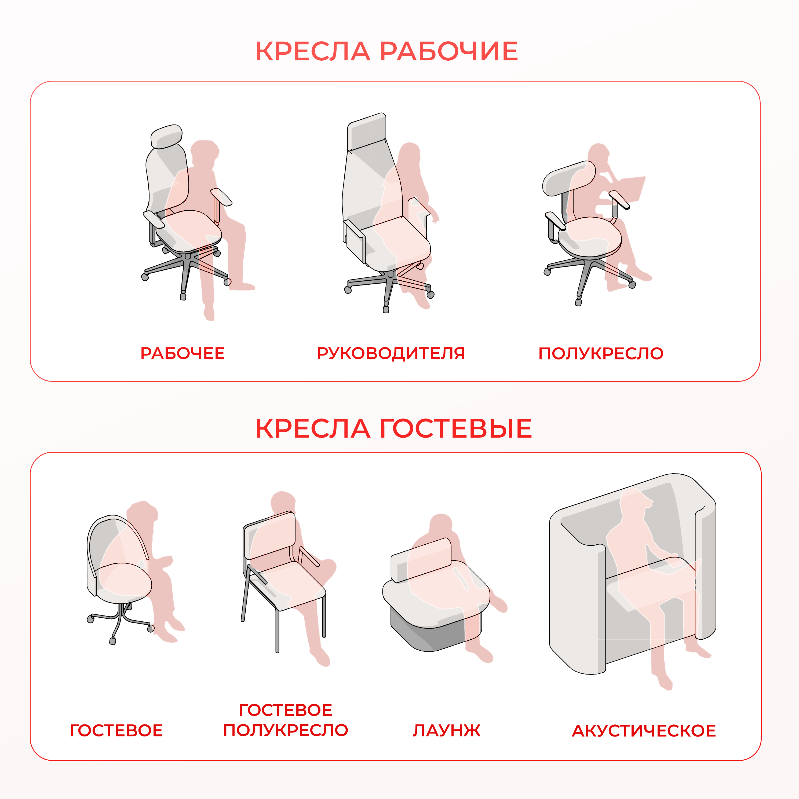

*Офисные кресла* состоят из 2 групп: **рабочие** и **гостевые** кресла. Всего 7 универсальных семейств.

### КРЕСЛА РАБОЧИЕ

Мебель для длительной индивидуальной работы сотрудников, где ключевым фактором является эргономика и мобильность.

**Кресло рабочее** — мобильное регулируемое кресло на колесиках для ежедневной работы.

**Кресло руководителя** — статусное эргономичное кресло с высокой спинкой и повышенным уровнем комфорта для топ-менеджмента.

**Полукресло** — компактный рабочий стул облегченной конструкции с невысокой спинкой для экономии пространства.

### КРЕСЛА ГОСТЕВЫЕ

Мебель для кратковременного сидения посетителей, клиентов или коллег в зонах ожидания, отдыха и переговоров.

**Кресло гостевое** — легкий мобильный стул для быстрых встреч и совещаний у рабочего стола.

**Полукресло гостевое** — стационарный стул для комфортного приема посетителей в кабинетах.

**Кресло лаунж** — низкое, мягкое и широкое кресло для неформального общения и отдыха в лаунж-зонах.

**Кресло акустическое** — кресло с высокими звукоизолирующими стенками для уединенной работы и конфиденциальных звонков.

## 3. РАБОТА С СЕМЕЙСТВАМИ
   

В каждом семействе есть основные разделы со свойствами: **Графика**, **Материалы и отделка** и **Размеры**. Ниже разобрана инструкция к каждому разделу для семейств набора *Офисные кресла*.

### ГРАФИКА

**3.1  Видимость** управляет отображением элементов семейства.

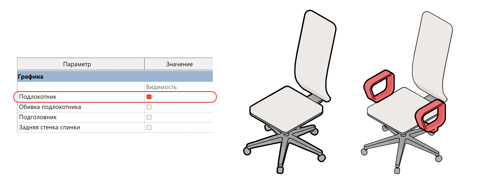

Вариативность наличия **подлокотника** предусмотрена в семействах:

- *Кресло рабочее*
- *Полукресло*
- *Кресло гостевое*
- *Полукресло гостевое*
- *Кресло лаунж*
  

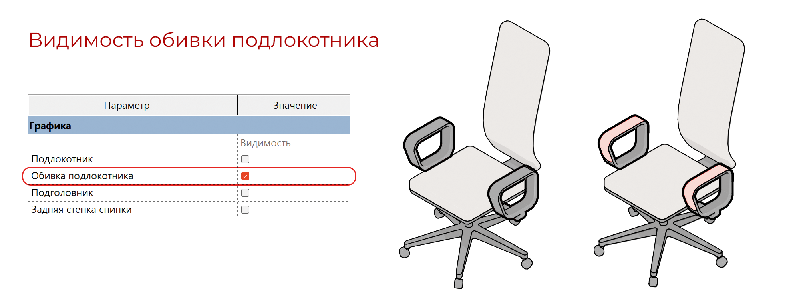

**Обивка подлокотника** как дополнительная визуальная опция работает для семейств:

- *Кресло рабочее*
- *Полукресло*
  

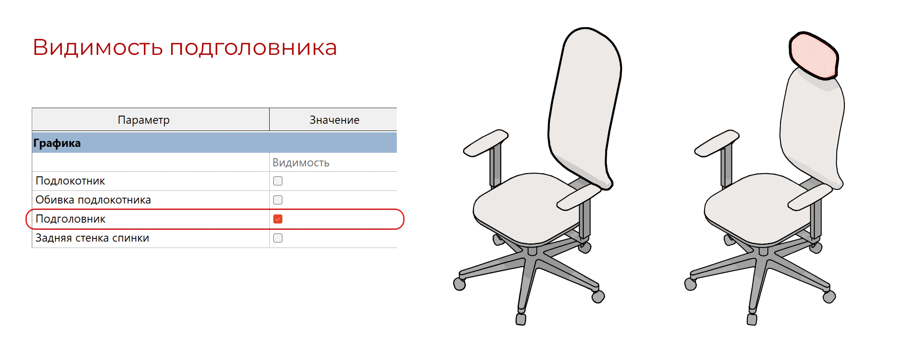

**Подголовник** по кнопке регулируется для семейств:

- *Кресло рабочее*
- *Кресло руководителя*
  

Иногда **спинка** только мешает рабочему процессу — функция ее вариативности заложена для сидений:

- *Полукресло*
- *Кресло лаунж*
  

Для *Рабочего кресла * можно включить видимость **задней стенки спинки** в цвет каркаса.

  
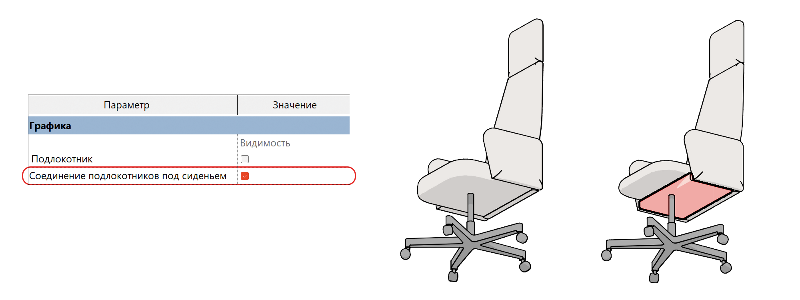

Видимость соединения под сиденьем – **поперечины** – работает для семейства *Кресло руководителя*. Для визуальной эстетики кресла советуем использовать этот параметр только для типов подлокотника *Прямой* и *Г-образный*.

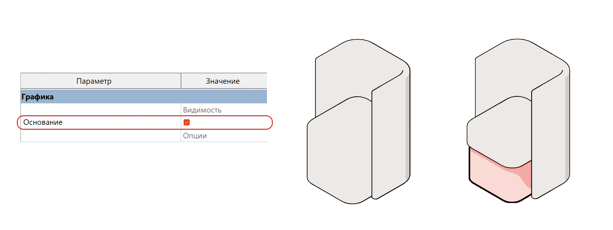

Для *Акустического кресла* предусмотрена функция дополнительного **основания** под сидением. При выключении этой видимости данную роль выполняет сиденье, дотягиваясь по высоте до пола.

**3.2  Опции** позволяют управлять вариативностью: переключать его состояние, параметры и доступные варианты.

У кресел есть опция смены **типа подлокотников**. У каждого семейства свой базовый набор. Ниже рассмотрим все типы.

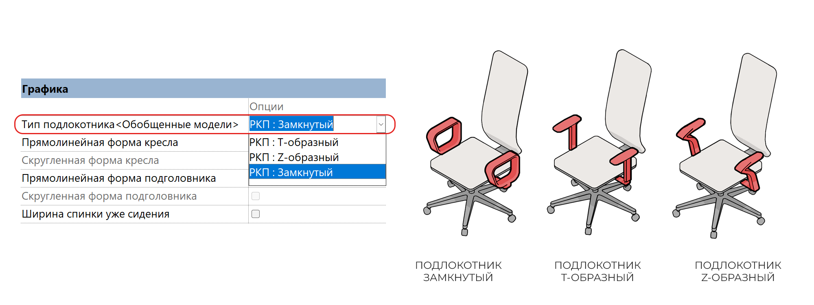

*Кресло рабочее*: **замкнутый**, **Т-образный** или **Z-образный** подлокотник.

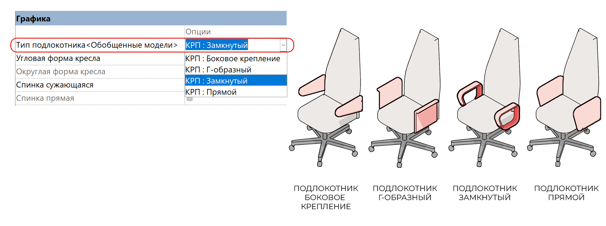

*Кресло руководителя*: подлокотник с **боковым креплением**, **Г-образный**, **замкнутый** или **прямой**.

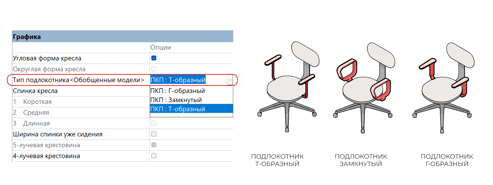

*Полукресло*:  **Г-образный** **замкнутый** или **Т-образный** подлокотник.

Опция регулировки общей формы по степени угловатости, **прямолинейная** или **скругленная форма кресла**, заложена для семейств:

- *Кресло рабочее*
- *Кресло руководителя*
- *Полукресло*
- *Кресло гостевое*
- *Кресло лаунж*
  

Аналогичная настройка **формы для подголовника** отдельно доступна для *Кресла рабочего*.

У *Кресла рабочего* опционально настраивается **сужение ширины спинки** относительно сиденья.

У *Кресла руководителя* отдельно настраивается **сужение верхней части спинки**.

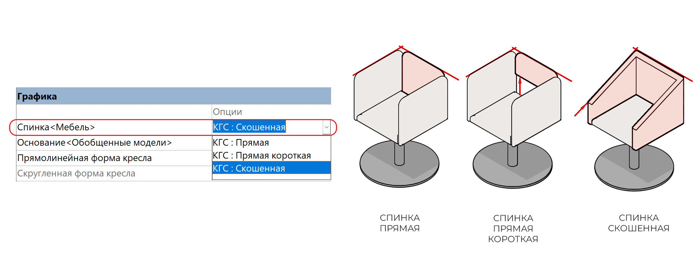

Спинка *Гостевого кресла* может быть **скошенной** или **прямой**. Дополнительно прямая спинка укорачивается по высоте отдельным типом из списка (**прямая короткая**), но только для прямоугольной формы кресла.

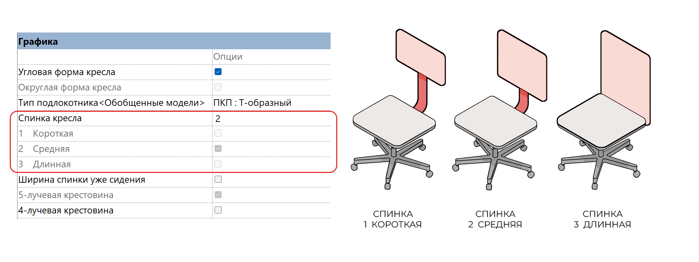

Для *Полукресла* заложены 3 варианта **высоты спинки**, которые регулируются с помощью введения цифры: 1 – короткая спинка, 2 – средней длины спинка, 3 – длинная спинка до сиденья.

Сценарий **встроенной** или **отдельной спинки** заложен для *Полукресла гостевого*. Конфигурация кресла может меняться в зависимости от типа каркаса, при этом опция разделения спинки работает для любой конфигурации.

**Скругление сиденья спереди** для *Полукресла гостевого* работает для всех типов каркаса, кроме *Ножки прямые* и *Ножки скошенные*.

Также опционально для этого семейства можно интегрировать текстильную **мягкую вставку**. В зависимости от конфигурации каркаса она может заменить твердую спинку, все сиденье целиком, включая подлокотники, или добавиться на сиденье отдельной вставкой.

У *Кресла лаунж* можно **закрыть сиденье спинкой**.

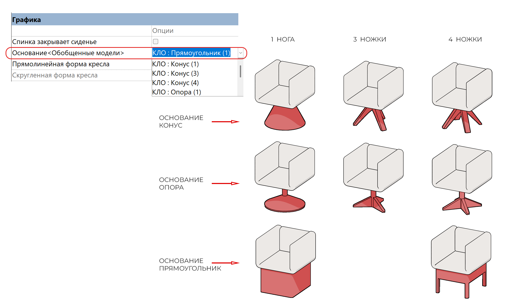

У этого же семейства (*Кресло лаунж*) есть несколько типов оснований: **конус**, **опора** и **прямоугольник**. Цифра в скобках — (1), (3) или (4) — указывает на количество ножек у опоры.

Типы оснований для *Гостевого кресла*: **конус**, **опора**, **паук**, и **крестовина**. Цифра в скобках — (1), (3), (4) или (5) — подскажет количество ножек у опоры. Ножки-пауки могут быть с роликами.

Внутри семейства *Гостевого полукресла* заложено 5 типов каркаса: с **прямыми** и **скошенными ножками**, каркасы **Y-образной**, **X-образной** и **S-образной формы**. Типы каркаса влияют не только на основание, но и на форму корпуса кресла.

Типы оснований семейства *Полукресло*: **5-лучевая** или **4-лучевая крестовина**.

Типы оснований семейства *Акустическое кресло*: **квадратные** или **круглые ножки**, **цоколь**, **Х-основание** и **пусто** (пустое пространство под сиденьем).

### МАТЕРИАЛЫ И ОТДЕЛКА

**3.3  Материалы** задают отделку отдельных частей модели (сиденья, каркаса и др.) 

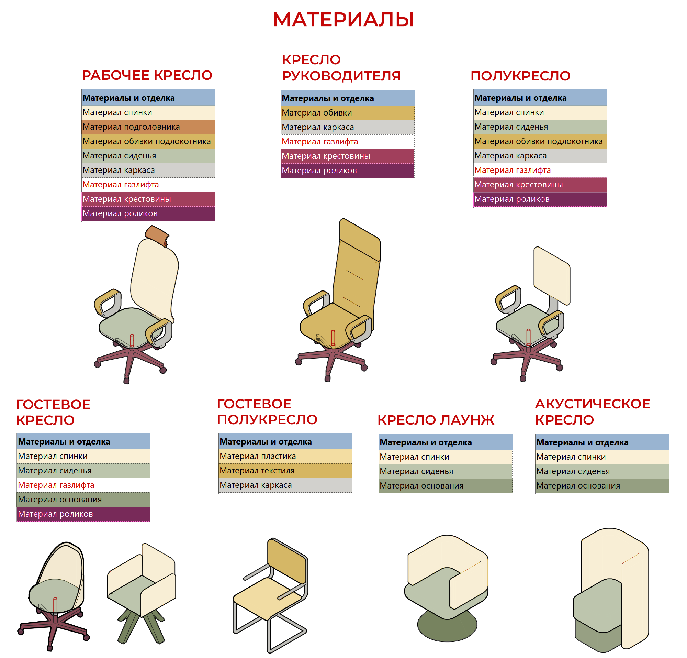

### РАЗМЕРЫ

**Габариты** определяют общие геометрические параметры кресла: ширину, глубину и высоту. Все дополнительные элементы и опции, например, подголовник или подлокотники, вписываются в эти габариты. Базовые размеры на плане определяются шириной и глубиной корпуса кресла (не основанием изделия).

**Размещение** отвечает за положение частей и элементов семейств.

   
**Размеры элементов** задают размеры отдельных частей и составляющих семейства.

**Высота сиденья** — отметка от пола до посадочной поверхности. **Высота спинки** — размер от высоты сиденья до верха спинки. Эти размеры задаются для всех семейств.

